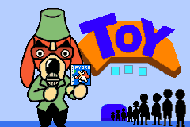
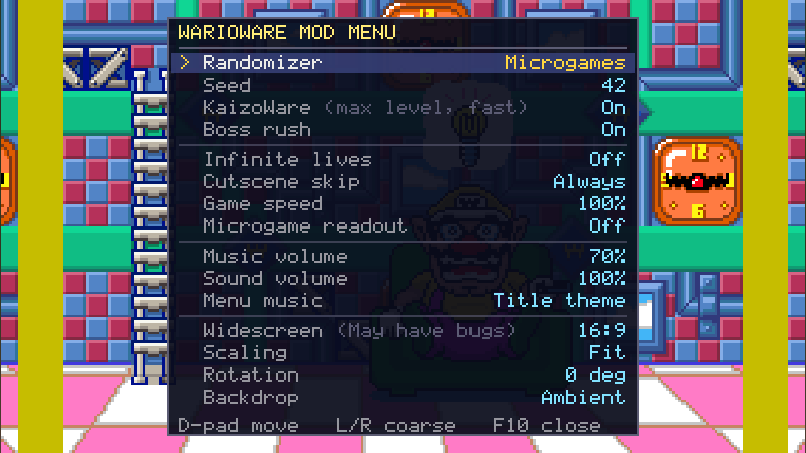
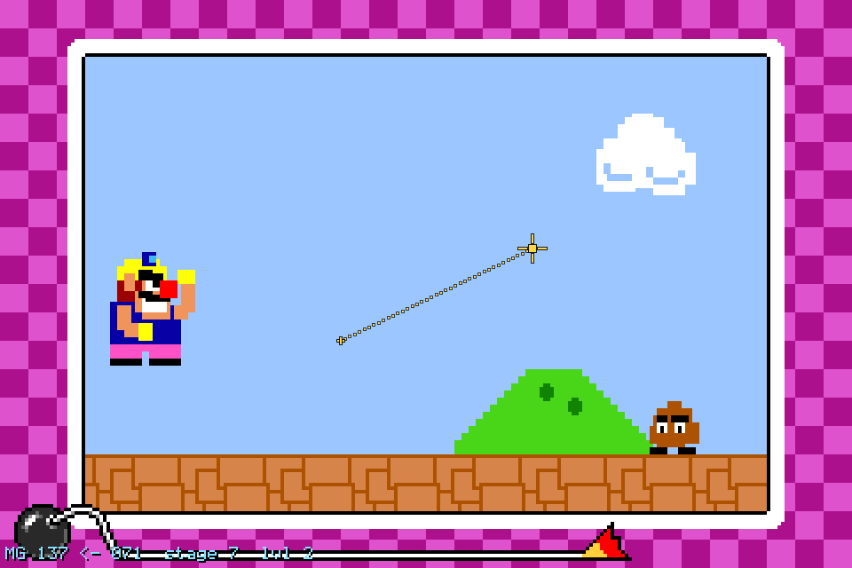
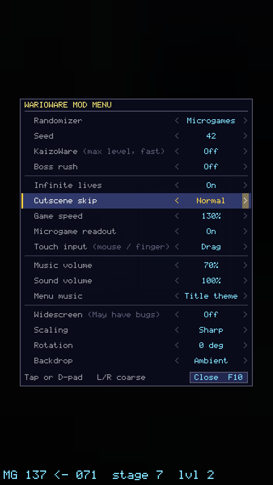
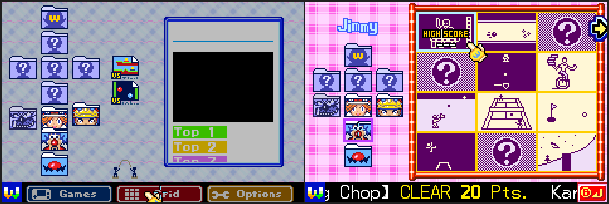
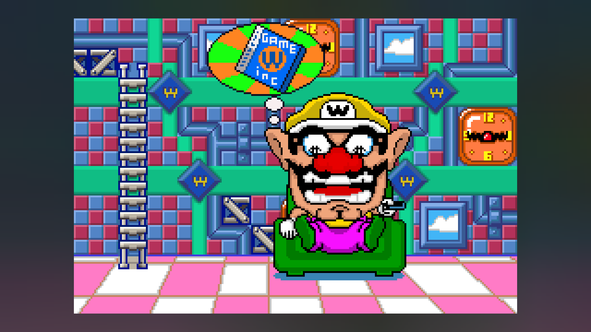
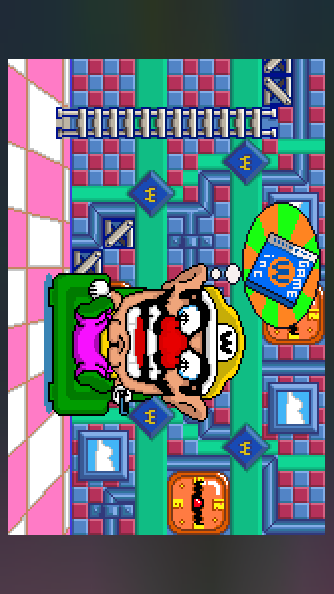
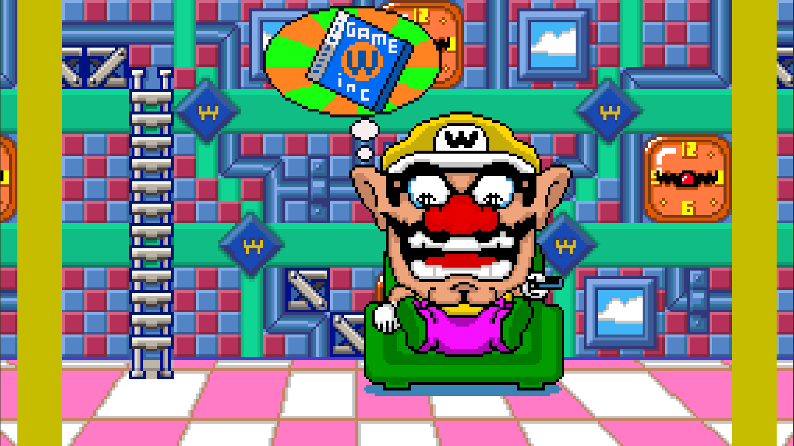
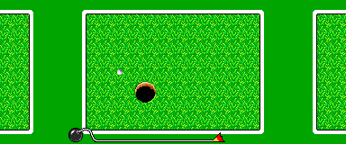

# gbarecomp — WarioWare laeuft nativ auf dem Mac

`gbarecomp` ist ein **statischer Recompiler**, kein Dekompiler. Er uebersetzt
ARM/THUMB-Maschinencode instruktionsweise in C++, das einen CPU-Zustand
bearbeitet:

```c
/* 080000C0  A mov r0,#0x12 */
g_cpu.R[15] = 0x080000C0u;
_r_080000C0 = 0x00000012u;
g_cpu.R[0] = _r_080000C0;
```

Verhaltenstreu, aber ein Emulator in C-Form — kein Quelltext. Fuer die
Dekompilierung unter `../` bringt er nichts; er erzeugt nicht die Sache, die
dort entsteht. Als **spielbares Artefakt** dagegen sehr wohl.



## Spielen

```
./port/gbarecomp/wariowarerecomp \
    --config port/gbarecomp/wariowareinc.toml \
    --rom rom.gba --bios gba_bios.bin
```

`--no-window --frames N --dump-png DATEI` rendert kopflos ein Einzelbild.
`--scale N`, `--fullscreen`, `--save-path` gibt es auch; `--help` listet alles.
**F10** oeffnet das Mod-Menue (Zufallsmodus, Tempo, Leben, Lautstaerken,
Fensterform -- eigene Abschnitte weiter unten). Im Hauptmenue des Spiels
oeffnen Maus und Finger die Reiter, Ordner, Gitterfelder und Optionen direkt. Das Fenster ist frei
ziehbar; `WWMOD_NO_VIEW=1` schaltet auf die alte Darstellung zurueck.

**Achtung:** `--screen MODE` zerlegt die Argumentauswertung (die Laufzeit
verliert danach die ROM-Pruefsumme). `GBARECOMP_SCREEN=raw` als Umgebungs-
variable tut dasselbe ohne den Fehler.

Neu bauen: `sh port/gbarecomp/build.sh` (braucht `cmake` und SDL2 aus brew).

## Messwerte

| | |
|---|---|
| Recompilieren der ROM | 0,07 s → 2811 Funktionen, 14 MB C++ |
| Linken des Runners | rund 7 s |
| Laufgeschwindigkeit | 1800 Bilder in 3,9 s ≈ **460 FPS**, 7,7-fache Echtzeit |
| Speicherzugriffsfehler | `unmapped=0 io_unhandled=0` |

## Was der Decomp beigesteuert hat

Zwei Dinge, die dieses Projekt hat und ein blanker Recompiler nicht:

**Die Datenkarte.** `wariowareinc.ld` sagt Zeile fuer Zeile, welcher ROM-Bereich
Code ist und welcher Daten. Der letzte `.text`-Eintrag endet bei `0x080F6140` —
alles danach sind 7,3 MB Grafik, Animation, Audio und `data.bin`. Ohne diese
Bereiche in der `game.toml` dekodiert die Funktionssuche Grafik als Code:

| | Funktionen | `undefined` |
|---|---|---|
| ohne Konfiguration, mit 5480 Symbolen | 48.223 | 123 |
| mit Datenbereichen | 2.811 | **0** |

**Die Symbolnamen.** `ww_symbols.tsv` enthaelt 5480 Funktionsadressen aus
`wariowareinc-main/asm/`. In einem Lauf mit allen Symbolen meldete der Finder
`manual_seeds_only: 1751` — so viele Funktionen haette er ohne den Decomp
verloren. Fuer den ausgelieferten Build sind stattdessen nur die 24 Adressen
als `[[extra_func]]` eingetragen, die im Laufprotokoll als `bridged` auftauchten;
das haelt die Ausgabe bei 14 MB statt 274 MB.

## Drei Befunde aus dem Zusammenspiel

**1. Die IWRAM-Blobs, unabhaengig bestaetigt.** Die Laufzeit kann vier Adressen
nicht statisch aufloesen: `0x03000C18`, `0x030003A8`, `0x03003640`,
`0x03007E3C` — allesamt IWRAM. Das sind genau die ARM-Routinen (Division,
Wurzel, RLE), die das Spiel zur Laufzeit dorthin kopiert und die im Decomp als
"nicht portierbar" markiert sind. Zwei voellig verschiedene Verfahren, derselbe
Befund.

**2. Ein Widerspruch, den keiner allein gefunden haette.** Bei `0x080F0224` und
`0x080F04CC` wird nachweislich Code ausgefuehrt (die Laufzeit bruecken sie), aber
der Decomp fuehrt diesen Bereich als Datenblock `bin/data_080EFE84.bin`. Einer
von beiden irrt — vermutlich enthaelt der Blob Code, den der Decomp noch nicht
herausgeloest hat. Das Werkzeug meldet es als harten Fehler:

```
CONFIG ERROR [[extra_func]] at 0x080F0224 falls inside [[data_range]]
  [0x080EFE84, 0x080F0D58) — bin/data_080EFE84.bin
```

**3. Ein Portabilitaetsloch in gbarecomp.** Die Selbstheilung (Nachkompilieren
verpasster Funktionen zur Laufzeit) uebergibt `--export-all-symbols` an den
Linker — ein MinGW-Flag, das Apples `ld` nicht kennt. `GBARECOMP_HEAL_CXX`
zeigt zwar auf clang, der Link scheitert aber daran. Folge: neun Funktionen
laufen im Interpreter statt kompiliert. Bei 460 FPS faellt das nicht auf.

## Ton: die Quellrate folgte SOUNDBIAS nicht

**Symptom:** Musik unkenntlich verzerrt, Effekte grob erkennbar.

**Ursache, gemessen.** `host_window.cpp` setzte beim Oeffnen des Audiogeraets
fest `cfg.source_rate = 65536.0` mit dem Kommentar "engine's standardized GBA
mixer rate". Das ist keine Konstante: die Rate folgt SOUNDBIAS (0x04000088,
Bits 14-15), und `gba_audio.h` haelt selbst 32768 Hz als Standard fest. Mit
`GBARECOMP_AUDIO_PROBE=1`:

```
[audio] SOUNDBIAS=0x0200 Aufloesung=0 -> 32768 Hz    Einschalten
[audio] SOUNDBIAS=0x4200 Aufloesung=1 -> 65536 Hz    das BIOS
[audio] SOUNDBIAS=0x0200 Aufloesung=0 -> 32768 Hz    WarioWares Soundtreiber
```

Das Spiel produziert 32768 Hz, abgespielt wurde mit 65536 Hz: **doppelte
Geschwindigkeit, eine Oktave zu hoch**. Lange tonale Linien werden dadurch
unkenntlich, kurze Effekte bleiben grob erkennbar -- genau das gemeldete Bild.
Der feste Wert stammt aus der Arbeit am BIOS-Klang, wo er zufaellig stimmt.

**Korrektur.** `HostWindow::set_audio_source_rate()` fuehrt die Rate nach; die
Praesentationsschleifen rufen sie vor jedem `drain_samples()` mit
`bus.audio().sample_rate()` auf. Das DRC-Servo rechnet seinen Resample-Schritt
in der naechsten Runde daraus neu. Details und Diff in `audio-rate-fix.patch`.

Der gbarecomp-Klon unter `../../gbarecomp/` ist damit **gepatcht** -- `build.sh`
baut die Korrektur mit. Beim Aktualisieren auf eine neue Fassung geht sie
verloren; der Patch liegt deshalb daneben.

## Ton: der Sound-DMA fehlte der Abschluss-Interrupt

Der eigentliche Grund, warum das Spiel nach roboterhaftem Rauschen klang. Nicht
im Audiopfad — im DMA.

WarioWare initialisiert seine Soundengine in dem Frame, in dem der Vorspann an
den Hauptteil uebergibt (hier Frame 273, direkt nach einem `RegisterRamReset`):

```
DMA1CNT_H = 0        abschalten
DMA2CNT_H = 0
DMA1SAD   = 0x03001068     DMA2SAD = 0x03001688
DMA1DAD   = 0x040000A0     DMA2DAD = 0x040000A4   (FIFO A / B)
DMA1CNT_H = 0xB600   einschalten
DMA2CNT_H = 0xF600   einschalten + IRQ
```

`0xF600` hat Bit 14 gesetzt, das Spiel will also einen DMA2-Abschluss-Interrupt.
Dazu passt `IE = 0x2401` (Bit 10 = DMA2) und dass der Interrupt-Verteiler
`IntrMain` in IWRAM DMA2 **vor** VBlank prueft — die Soundengine haengt an
diesem Interrupt.

`GbaIo::run_sound_fifo_dma` loeste ihn nicht aus. `run_immediate_dma` und
`run_timed_dma` taten es beide; nur der FIFO-Pfad hatte den Zweig nicht. Also
tickte die Engine nach ihrer Initialisierung nie wieder, der Quellzeiger lief
mangels Neustart durch das IWRAM (gemessen: 73 KB am Stueck, weit ueber das
Puffer-Ende hinaus) und der FIFO spielte ab, was dort zufaellig stand.

Fix: am Ende von `run_sound_fifo_dma` denselben Zweig wie in den anderen beiden
Pfaden.

```c
if (cnt_h & 0x4000u) {
    request_irq(static_cast<uint16_t>(1u << (8 + channel)));
}
```

Messwerte vor/nach, jeweils die Spielphase ab Frame 274, als 8-Bit-PCM direkt
aus dem DMA-Strom rekonstruiert:

| | mittlere Sample-Differenz | RMS | Anteil \|v\|>100 |
|---|---|---|---|
| vorher | 13,41 | 29,3 | 3,3 % |
| nachher | 2,62 | 15,0 | 0,0 % |
| Referenz: BIOS-Klang | 5,11 | 14,2 | 0,0 % |

DMA-Neustarts nach Frame 273: vorher 0, nachher 46 — sauber im 7-Frame-Takt
(MP2Ks `pcmDmaPeriod`), `SAD` jedes Mal korrekt auf den Pufferanfang
zurueckgesetzt.

### Wie die Diagnose lief

Der Umweg ist es wert, notiert zu werden, weil zwei Zwischenstaende falsch
waren:

1. Die Rate folgte SOUNDBIAS nicht (Abschnitt oben). Echter Fehler, aber nicht
   dieser — der Vorspann klang danach richtig, das Spiel weiter falsch.
2. „Das Spiel haengt in der VBlank-Warteschleife bei `0x08000F62`." Falsch. Die
   Zahl `cycles` im Abschlussbanner ist nicht der laufende Zyklenzaehler; sie
   steht still, waehrend das Spiel laeuft. Ein Mitschnitt der Zugriffe auf
   `gVBlankFlag` (0x03000000) zeigte 128 saubere Frame-Zyklen: Handler setzt,
   Schleife quittiert. Die Warteschleife ist genau der Ort, an dem ein gesundes
   Spiel den Grossteil der Zeit verbringt.

Was tatsaechlich zum Ziel fuehrte: jede DMA-Nachfuellung mit Quelladresse **und**
Frame-Nummer mitschreiben. Damit war sofort sichtbar, dass die Aktivierungen im
7-Frame-Takt bis Frame 273 laufen und dann abreissen, waehrend die Nachfuellungen
weiterlaufen.

## Mod-Menue



**F10** oeffnet und schliesst es, ebenso **Start** und die Tastenkombination
**L+R+Select** (damit es auch ohne Tastatur erreichbar bleibt). Das
Steuerkreuz waehlt, Links/Rechts stellt ein, L und R springen grob. Der Gast
sieht davon nichts -- der Mod gibt ihm 0x03FF (nichts gedrueckt) weiter.

Das Spiel wird dabei **nicht** angehalten. Stattdessen schiebt der Mod beim
Oeffnen einen kurzen Start-Impuls ein und beim Schliessen einen A-Impuls: das
Spiel geht damit in seine *eigene* Pause und wieder heraus. Der Umweg ist der
Grund, warum im Menue ueberhaupt etwas zu hoeren ist -- ein angehaltener Gast
erzeugt keine Samples, seine Soundengine haengt am DMA2-Interrupt.

| Schalter | Wirkung |
|---|---|
| Randomizer | Off / Microgames / With bosses |
| Seed | 1..9999, macht einen Lauf wiederholbar |
| KaizoWare | hoechste Stufe ab dem ersten Microgame, Tempo mindestens 200 % |
| Boss rush | jede Stage springt nach einem Microgame zu ihrem Boss |
| Infinite lives | fuellt `currentLives` je Bild auf `maxLives` |
| Cutscene skip | `Always` hebt die Erstspiel-Sperre auf |
| Game speed | 50..300 % auf `set_beatscript_tempo` |
| Microgame readout | Nummer, Stage und Schwierigkeit ins Bild |
| Touch input | Off / Drag / Flick -- Maus oder Finger statt Tasten |
| Music volume | 0..100 % |
| Sound volume | 0..100 % |
| Menu music | Titelmusik im Menue, oder aus |
| Widescreen (May have bugs) | Aus / 16:10 / 16:9 / 21:9 / Max / Auto |
| Scaling | Sharp (ganzzahlig) / Fit / Stretch |
| Rotation | 0 / 90 / 180 / 270 Grad |
| Backdrop | Ambient / Black |

Alles laesst sich vorab setzen: `WWMOD_RANDOM=games|all`, `WWMOD_SEED=N`,
`WWMOD_SPEED=N`, `WWMOD_MUSIC_VOLUME=N`, `WWMOD_SOUND_VOLUME=N`,
`WWMOD_ROTATION=0|90|180|270`, `WWMOD_WIDESCREEN=16:9|16:10|21:9|max|auto`,
`WWMOD_SCALING=sharp|fit|stretch`, `WWMOD_BLACK_BACKDROP=1`,
`WWMOD_INFINITE_LIVES=1`, `WWMOD_SKIP_CUTSCENES=1`, `WWMOD_KAIZO=1`,
`WWMOD_BOSS_RUSH=1`, `WWMOD_READOUT=1`, `WWMOD_TOUCH=drag|flick`,
`WWMOD_TOUCH_TABLE=<Pfad>`,
`WWMOD_NO_MENU_MUSIC=1`, `WWMOD_NO_VIEW=1` (Darstellung wie ohne Mod).
Zum Nachpruefen ohne Bildschirm: `WWMOD_TRACE=1` schreibt je Microgame-Start
eine Zeile, `WWMOD_TEST_MENU=<Bild>` oeffnet und schliesst das Menue von
selbst, `WWMOD_DUMP_COMPOSE=<Pfad>` legt einen zusammengesetzten Rahmen als
PPM ab.

## Zufallsmodus

`func_08008E1C` startet jedes Microgame. Es liest die Reihenfolgetabelle
`unk71[unk70]`, holt daraus einen 8-Byte-Eintrag der Stage-Liste und legt
vier Dinge ab, bevor es die Szene startet:

```
08008E9C  STRB R1,[R0]  (0x174)   Schwierigkeit = Eintrag.Byte0
08008F16  STRB R0,[R1]  (0x27C)   currentMicrogameID = Eintrag.Wort0 >> 8
08008F82  STR  R0,[R6,#0xC]       Musik = Eintrag+4, sonst D_083A50E0[x].unk4
08008FCA  STRB R0,[R1]  (0x172)   Rahmenskript = D_083A50E0[x].unk8
080090EA  LDR  R0,[R0]            args[1] = D_083A50E0[x].unk0
080090FA  BL   set_beatscript_subscenes    R0 = &args[0]
```

Der Mod haengt sich an diesen letzten Aufruf. `g_runtime_fn_entry_hook`
steht in jedem rekompilierten Funktionsprolog, R14 == `0x080090FE`
identifiziert die Aufrufstelle eindeutig, und R0 zeigt auf
`{Rahmenskript, Microgame-Skript, 0}` im Gaststack. Keine ROM wird
veraendert, kein Byte der Dekompilierung angefasst.

Die Wahl ist eine **reine Funktion** aus Seed, Stage, `unk70` und
Punktestand. Das ist kein Schoenheitsfehler, sondern noetig: laesst
`runtime_should_yield()` eine Gastfunktion neu beginnen, schlaegt der Haken
ein zweites Mal an -- eine reine Funktion trifft dann dieselbe Wahl, und der
Eingriff bleibt folgenlos wiederholbar. Nebenbei wird ein Lauf damit ueber
den Seed teilbar.

### Die Musik gehoert zum Microgame

Der erste Wurf tauschte nur `args[1]` und die Nummer -- und liess damit die
Musik des *ersetzten* Spiels laufen. `func_08008E1C` setzt
`gGameplayData.unkC` naemlich schon vorher, und zwar aus
`D_083A50E0[Spiel].unk4`, wenn der Stage-Eintrag keine eigene Musik nennt.
Der Mod schreibt es nach -- aber nur, wenn `unk228 == 0` ist; bei 1 und 2
stammt die Musik aus einer Auswahlliste (Stage-Medley), und die bleibt.
Belegt am Trace, Seed 42:

```
Spiel 1:   3 -> 121 (SUPER MARIO)      Musik 1031 'm_BGM_BOMB_31_Mario'
Spiel 2: 137 ->  82 (SEESAW)           Musik 1011 'm_BGM_BOMB_11'
```

Vorher waere hier 1004 bzw. 1064 gelaufen -- die Musik der Plaetze, nicht
die der Spiele.

### Warum nur innerhalb der Gruppe getauscht wird

`D_083A50E0[i].unk8` teilt die 250 Eintraege in vier zusammenhaengende
Bloecke. Der Klartextname in `.unkC` sagt, was sie sind:

| `unk8` | Eintraege | | Beispielname |
|---|---|---|---|
| 1 | 0..190 | 191 | `DODGE WITH JUMP` |
| 2 | 191..214 | 24 | `L. CUP NOODLE` |
| 4 | 215..240 | 26 | `LP. STREET FIGHT` |
| 6 | 241..249 | 9 | `REST WARIO2` |

Das sind gewoehnliche Microgames, Bossspiele, freischaltbare Spiele und
Zwischenbilder -- verschiedene Spielarten, nicht bloss verschiedene Rahmen.
Der erste Versuch tauschte quer durch alle 250. Gemessen ueber 12000 Bilder
mit demselben Eingabeband:

| | Microgame-Starts |
|---|---|
| aus | 0 Tausche, Lauf gesund |
| gruppentreu | 21 Tausche, Lauf gesund |
| quer durch alles | 7 Tausche -- nach dem ersten gruppenfremden **Stillstand** |

Ein freischaltbares Spiel (`LP.`) endet nicht von selbst; in einem
Microgame-Platz haengt der Stage-Ablauf. Der Tausch bleibt deshalb immer in
seiner Gruppe. Die beiden Modi unterscheiden nur, **welche** Gruppen
angefasst werden: *Microgames* laesst Bosse, Zwischenbilder und
freischaltbare Spiele stehen, *With bosses* fasst jede Gruppe an -- jeweils
in sich.

## KaizoWare und Boss Rush

Beide sind keine neuen Mechaniken, sondern zwei Felder, die das Spiel selbst
fuehrt.

**Schwierigkeit.** `gGameplayData.currentDifficulty` (+0x174) setzt
`func_08008E1C` bei jedem Microgame-Start aus Byte 0 des Stage-Eintrags, und
35 Microgames lesen es ueber `func_0800A024`. Der Wertebereich steht in
`func_080A190C`: der Index wird als `(Sprache * 3 + Stufe) * 4` gebildet,
also Dreiergruppen -- Stufen 0, 1, 2, und **2 ist die haerteste**. KaizoWare
zieht das Feld je Bild auf 2 nach. Gemessen ueber 12000 Bilder:

| | Anhebungen 0 -> 2 |
|---|---|
| aus | 0 |
| an | 70 |

Siebzig Anhebungen bei neunundsechzig Microgame-Starts -- eine je Start,
genau wie erwartet: das Spiel setzt die Stufe beim Start zurueck, der Mod
hebt sie im naechsten Bild wieder an.

**Tempo.** Dieselbe Stellschraube wie der Geschwindigkeitsregler
(`set_beatscript_tempo`), nur als Untergrenze: KaizoWare faehrt mindestens
200 %, der Regler darf hoeher. Wirkung im selben Lauf: 21 Microgame-Starts
bei 100 %, 69 mit KaizoWare.

**Boss Rush.** `gGameplayData.unk6c` zeigt auf `struct GameplayStruct6c`,
dessen `unk0_1` (Bits 0..7 des ersten Worts) sagt, wie viele Microgames vor
dem Boss kommen. `gameplay_run_script` Fall 0 endet mit

```c
if (gGameplayData.unk70 < scriptTarget->unk0_1) { func_08008E1C(); return 0; }
```

`unk70` auf die Schwelle zu heben laesst die Stage nach dem naechsten
abgeschlossenen Microgame zum Boss springen -- und `func_08008E1C` greift
dann gar nicht mehr in die Reihenfolgetabelle, es gibt also nichts, was
danebengreifen koennte. Gemessen, verteilt ueber die Position des Microgames
in der Stage:

| Position | 0 | 1 | 2 | 3 | 4 | 5 |
|---|---|---|---|---|---|---|
| aus | 5 | 4 | 4 | 4 | 3 | 1 |
| an | 9 | – | – | – | – | – |

Der erste Microgame-Start je Stage bleibt stehen: Fall 1 des Skripts ruft
`func_08008E1C()` unbedingt, bevor die Schwelle ueberhaupt geprueft wird.
Es ist also genau genommen "ein Microgame, dann der Boss" -- mit dem
Zufallsmodus dazu ist der Boss jedes Mal ein anderer.

### Was noch fehlt: die Anweisungstexte

Der dritte Teil der KaizoWare-Idee -- das eingeblendete Kommandowort
verwuerfeln -- ist nicht drin, und zwar nicht aus Bequemlichkeit. Zwei Wege
sind nachgesehen und beide fuehren nicht hin:

`currentMicrogameID` (+0x27C) hat im ganzen Spiel nur **zwei** Leser, beide
in Microgames selbst und beide der Form `EORS R0, #0x65` bzw. `#0x72` --
"bin ich Spiel 101?". Die Nummer treibt den Text also nicht.

Die Tabelle bei `0x083A6090`, direkt hinter `D_083A50E0`, haelt 228
Shift-JIS-Zeichenketten der Form

```
【ＣRAZY_ＣARS】@0_ＤON’T_GET_SMASHED_BY_THE_CRAZY_CARS!
【ＬOG_ＣHOP】@0_ＫARATE’S_LIKE_MY_COLOGNE：_OVERPOWERIN’!
```

-- Titel und Erklaertext fuer die Uebersichtsliste, nicht das kurze Wort,
das beim Start eingeblendet wird. Das steckt im Skript des jeweiligen
Microgames und laesst sich damit nicht vom Spiel trennen, das man
tatsaechlich bekommt. Wer es will, muss die Anzeigeroutine finden -- das ist
eine eigene Grabung, keine Stellschraube.

## Zwischenszenen: die Sperre, nicht der Sprung

Das Spiel kann Zwischenszenen von sich aus ueberspringen -- es verbietet es
nur beim ersten Mal. `gameplay_run_script` prueft zwei Tore, bevor A, B oder
Start eine Szene abbrechen duerfen:

```c
if ((scriptState->unk0 & 1) != 0) {          // Tor 1: Abschnitt ist ueberspringbar
    ...
    if (gGameplayData.unk6_8 != 0) {          // Tor 2: Erlaubnis
        if (gPressedKeys & (A_BUTTON | B_BUTTON | START_BUTTON)) { ... }
```

Tor 2 vergibt `func_0801720C`, und das ist die ganze Erstspiel-Logik:

```
R0 = func_080007C0(id)          schon gesehen?
if (R0 != 0) func_0800A3A4(1)         -> Springen erlaubt
else       { func_0800A3A4(0)         -> beim ersten Mal verboten
             func_08000778(id)         und als gesehen vermerken
             func_0800A270(); }        und speichern
```

`func_0800A3A4` (0x0800A3A4) ist der einzige Schreiber von `unk6_8` ausser
zwei Stellen in `gameplay.c`, die es ohnehin auf 1 setzen. Abfangen liess es
sich trotzdem nicht: der Funktionsfinder hat die Adresse nicht als eigenen
Eintrag erfasst, im erzeugten Code gibt es kein
`g_runtime_fn_entry_hook(0x0800A3A4u)`. Der Mod setzt das Bit deshalb je Bild
selbst -- Bit 23 im Wort bei `gGameplayData+0x04`, wie `gameplay.h` es mit
`// 0x4:23` ausweist.

**Tor 1 bleibt unangetastet.** Welcher Abschnitt ueberhaupt ueberspringbar
ist, entscheidet weiter das Skript; der Mod vergibt nur die Erlaubnis. Ein
erzwungener Sprung an einer Stelle, die das Spiel nicht dafuer vorgesehen
hat, kaeme gar nicht erst zustande.

Gemessen, mit Gegenprobe -- gezaehlt wird nur, wenn das Spiel das Bit
*aktiv* loescht (beim Szenenwechsel ist das ganze Wort kurz genullt, das
zaehlt nicht mit), je 20000 Bilder mit demselben Eingabeband:

| Spielstand | Sperren aufgehoben |
|---|---|
| frisch angelegt | 1 (Stage 0, Zustand 6) |
| mit Fortschritt | 0 |

Genau das ist die Erstspiel-Sperre: beim frischen Spielstand verbietet das
Spiel den Sprung in der Einfuehrungs-Stage, beim gefuellten nie. Dass es nur
eine ist, liegt am Eingabeband -- der synthetische Tastendruecker kommt nicht
weiter als bis zur ersten Stage.

## Zeigersteuerung: Grundlage



WarioWare Inc. kennt keinen Cursor. Jedes Microgame liest `gPressedKeys` oder
`gCurrentKeys` -- es gibt im Spielzustand nichts, was man bewegen koennte.
Eine Maus- oder Fingersteuerung kann deshalb nur Tastendruecke **erfinden**,
und die einzige offene Frage ist, welche.

Vier Bausteine:

| | |
|---|---|
| `tap` | Aufsetzen = A, kurzer Impuls. Fuer "im richtigen Moment druecken". |
| `hold` | A gedrueckt, solange der Zeiger aufliegt. Fuer Halten und Aufladen. |
| `drag` | Ziehen = gehaltene Richtung, sobald die Totzone verlassen ist. |
| `flick` | Wischen = eine einzelne Flanke. Fuer Spiele, die `gPressedKeys` lesen statt `gCurrentKeys` -- dort verpufft ein gehaltener Druck. |
| `both` | tap + drag, die Voreinstellung. |

**Warum es eine Tabelle braucht.** Knopf oder Richtung ist das eine, Pegel
oder Flanke das andere. Neben der Exe liegt deshalb eine `touch.ini` mit
einer Zeile je Microgame; die Nummer ist `currentMicrogameID`, mit "Microgame
readout" steht sie waehrend des Spiels im Bild.

### Die Vorschlaege stehen in der ROM

Geraten werden musste weniger als gedacht. Jede Microgame-Beschreibung
(Tabelle `0x083A6090`, um 2 gegen `D_083A50E0` versetzt) traegt am Ende
ihres Erklaertextes die Symbole, die das Spiel selbst fuer die Steuerung
einblendet -- als Escape in den Text gesetzt:

```
【ＣRAZY_ＣARS】@0_ＤON’T_GET_SMASHED_BY_THE_CRAZY_CARS!  .e:1QR:0.3JUMP
【ＦRUIT_ＦALL】@0_ＣATCH_THE_FALLING_FRUIT_IN_YOUR_BASKET．  .e:1GH:0.3MOVE
【ＲEPELLION】@0_ＤESTROY_THE_ＵＦＯS!  .e:1GH:0.3MOVE .e:1QR:0.3SHOOT
```

Ueber alle 228 Beschreibungen gezaehlt:

| Code | Fundstellen | Verben |
|---|---|---|
| `QR` | 132 | JUMP, SHOOT, ENTER, DROP, CATCH, GRAB |
| `GH` | 76 | MOVE, SELECT, STEER, DODGE |
| `OP` | 41 | MOVE, SELECT, BURROW |
| `IJ` | 12 | MOVE, AIM, TRANSFORM |
| `EF` | 4 | DUCK, STEER, HIDE GUT |
| `KL`, `OJ`, `CD`, `MN` | je 1 | ATTACK, GUARD, –, MOVE |

`QR` ist der Knopf, der Rest sind Richtungen. Daraus folgt das Schema
unmittelbar: nur Knopf -> `tap`, nur Richtung -> `drag`, beides -> `both`.
`KL` und `OJ` kommen je einmal vor und sind nach ihrem Verb (ATTACK, GUARD)
als Knopf gewertet; `CD` kommt ohne Verb vor und bleibt ohne Vorschlag.

`gen_touch_ini.py` liest das aus der ROM und schreibt die Datei. Ausgeliefert
sind alle 250 Eintraege: **89 `tap`, 89 `drag`, 44 `both`, 9 `off`**, einer
von Hand auf `hold` gesetzt, und 19 ohne Vorschlag. Jede Zeile traegt Titel
und Verben als Kommentar, damit der Grund sichtbar bleibt:

```
  0 = tap      # CRAZY CARS -- JUMP
  1 = both     # REPELLION -- MOVE, SHOOT
  4 = drag     # SPACE ESCAPE -- MOVE
 31 = drag     # PAPER PLANE -- STEER
 44 = both     # MOUNTAIN MOUNTIN’ -- MOVE, JUMP
241 = off      # Zwischenbild -- keine Eingabe
```

Zwei Dinge musste der Erzeuger lernen. Die Beschreibungstabelle ist
**kuerzer** als die Microgame-Tabelle -- 228 Zeiger, also Beschreibungen bis
Microgame 225; ohne Grenze las er dahinter Rohdaten und schrieb sie als
Begruendung in die Datei. Und die neun Zwischenbilder
(`D_083A50E0[i].unk8 == 6`) bekommen `off`: dort ist nichts zu bedienen. Die
verbleibenden 19 sind die letzten freischaltbaren Spiele, fuer die es keinen
Hinweis in den Daten gibt -- sie bleiben auskommentiert statt geraten.

### Eine Durchsicht, die sich gelohnt hat

Fuenf Zeilen fielen bei einer Gegenprobe auf, weil ihr Verb dem Symbol
widersprach. Vier davon waren Fehlalarm -- das Verb fuehrt in die Irre, das
Symbol hat recht:

```
 97 = drag   # I CAME, I SAW -- CUT      "SAW THROUGH THE LOG"  -> hin und her
154 = drag   # WHAT’S YOUR BEEF? -- CUT  "MOVE THE KNIFE TO CUT THE STEAK"
```

Die fuenfte deckte eine Luecke auf. `60 CHIRITORIE` traegt das Knopfsymbol
mit dem Verb MOVE, und der Text erklaert warum: "CLEAN UP YOUR PLACE WITH
THIS REMOTE CONTROL VACUUM". Der Fernlenk-Staubsauger lenkt, **solange** der
Knopf gehalten wird -- ein kurzer Impuls trifft das nicht. Daher das neue
Schema `hold`, und `60 = hold` als einzige Ausnahme von Hand. Sie steht im
Erzeuger, nicht in der Datei, damit ein erneuter Lauf sie nicht wegwirft.

Dass sich `hold` nicht aus den Daten ableiten laesst, bleibt so: welches der
89 `tap`-Spiele in Wahrheit halten oder mashen will, sagt kein Symbol. Auch
`flick` nicht -- ob ein Microgame die Flanke oder den Pegel liest, steht in
seinem Code.

Wo sich ein Spiel traege anfuehlt, ist `flick` der naechste Versuch, wo ein
Tippen zu kurz greift, `hold`. Ohne Eintrag gilt, was im Menue steht.

**Der Zeiger kommt als Zustand, nicht als Ereignis.** `win.pump()` hat die
SDL-Warteschlange geleert, bevor der Mod an der Reihe ist; `SDL_GetMouseState`
und `SDL_GetTouchFinger` liefern trotzdem, was gebraucht wird. Finger haben
Vorrang vor der Maus, bei der Maus gilt die linke Taste als "aufgesetzt".

**Die Umrechnung ist die Umkehrung des Zeichnens.** Fensterpunkt ->
Zeichenflaeche (`compute_presentation_layout`, dieselbe Funktion, die
`HostWindow::present` benutzt) -> Spielbild (Massstab, Zentrierung, Drehung).
Das ist genau der Weg, den `blit_game` vorwaerts geht, rueckwaerts -- und
damit pruefbar. `ww_mod_preview --selftest` rechnet Punkte hin und zurueck:

```
  Drehung   0  Sharp    Fenster 1600x900   Flaeche 1600x900   groesster Fehler 0
  Drehung  90  Fit      Fenster  720x1280  Flaeche  675x1200  groesster Fehler 1
  Drehung 270  Stretch  Fenster  480x320   Flaeche  480x320   groesster Fehler 1
  ...
  3024 Punkte geprueft, 0 daneben
```

Vier Drehungen mal drei Skalierungen mal vier Fensterformen, groesster Fehler
ein Spielpunkt. Derselbe Selbsttest faehrt auch die Zustandsmaschine durch --
aufsetzen, ziehen, loslassen -- und zeigt, welche Tasten dabei herauskommen:

```
  Schema both (tippen+ziehen):        Schema flick (wischen):
    aufgesetzt   -> A                   aufgesetzt   -> -
    6 Punkte     -> A                   6 Punkte     -> -
    20 Punkte    -> Right               20 Punkte    -> Right
    losgelassen  -> -                   losgelassen  -> Right
```

Dass der Wisch-Impuls das Loslassen ueberlebt, ist Absicht: der Gast pollt
einmal je Bild, ein erfundener Druck muss drei Durchgaenge stehen, sonst
kommt keine Flanke an. Dieselbe Lehre wie beim Start-Impuls des Menues.

**Was das nicht ist.** Touched!-Spiele *waren* fuer den Stift entworfen, die
hier fuer ein Steuerkreuz. Diese Grundlage macht die Haelfte, bei der "im
richtigen Moment tippen" die ganze Wahrheit ist, sofort spielbar; alles mit
praeziser Richtungshaltung braucht die Tabelle. Und beides ist bisher
**gerechnet, nicht gespielt** -- der Selbsttest belegt die Umrechnung und die
Zustandsmaschine, nicht das Spielgefuehl.

## Menue per Maus und Finger



Ohne Tastatur kommt man jetzt hinein und kann alles bedienen:

| | |
|---|---|
| Oeffnen | Menueknopf oben rechts. Er erscheint, sobald sich der Zeiger regt, und blendet nach drei Sekunden Ruhe aus. |
| Zeile waehlen | antippen |
| Wert aendern | `<` und `>` an jeder Zeile; das Feld dazwischen schaltet weiter |
| Schnell aendern | Pfeil halten -- wiederholt nach 0,3 s, nach zwanzig Schritten grob |
| Schliessen | Knopf "Close", oder ausserhalb des Menues tippen |
| Maus | die Zeile unter dem Zeiger wird hervorgehoben |

Steuerkreuz, F10 und L+R+Select funktionieren unveraendert daneben.

**Aufsetzen oder Loslassen.** Pfeile und Werte wirken beim Aufsetzen, sonst
liesse sich nichts gedrueckt halten. Was etwas oeffnet oder schliesst, loest
dagegen erst beim Loslassen aus. Das hat zwei Gruende: ein Fehlgriff laesst
sich durch Wegziehen zuruecknehmen, und der Finger, der das Menue oeffnet,
schliesst es nicht im selben Atemzug wieder -- sein Loslassen gehoert noch
dem Knopf, auf dem er aufgesetzt hat.

**Ein Druck gehoert dem, was er beim Aufsetzen trifft.** Ist "Touch input"
eingeschaltet, geht ein Druck aufs Spielbild als A oder Richtung ans Spiel --
ein Druck auf den Menueknopf aber nie, auch wenn er ueber dem Spielbild
liegt. Der Zeiger wird dafuer genau einmal je Durchgang gelesen, und Menue
und Spiel teilen sich diesen einen Zustand.

**Zeichnen und Antippen aus derselben Rechnung.** `draw_menu` legt beim
Zeichnen jede Trefferflaeche ab -- Zeilen, Pfeilzonen, Wertfeld, Schliessen --,
und die Eingabe prueft gegen genau diese Zahlen. Aendert sich ein Abstand,
wandern die Flaechen mit.

**Das Wertfeld hat eine feste Breite**, elf Zeichen fuer den laengsten Wert
("Title theme"). Die Pfeile stehen dadurch in allen Zeilen uebereinander; das
Menue ist dafuer von 37 auf 46 Spalten gewachsen, weil "Touch input (mouse /
finger)" sonst ins Feld liefe.

**Hoehe fuer Finger.** Die Breite bestimmt die Schriftgroesse, die Hoehe
nicht. Was an Hoehe uebrig bleibt, geht in die Zeilen, bis sie knapp doppelt
so hoch sind -- im Hochformat 675x1200 von 22 auf 38 Bildpunkte, bei gleicher
Schrift. Im Querformat bei 720 Zeilen bleibt alles, wie es war.

**Nebenbei behoben:** die Hoehenrechnung zaehlte zwei Trennlinien, gezeichnet
wurden seit Boss Rush drei. Die Fusszeile sass deshalb auf dem unteren Rand --
im Bild zum KaizoWare-Abschnitt noch zu sehen.

### Belegt, ohne Hand am Zeiger

Die Menuelogik (`ui_step`) ist frei von SDL und bekommt Flaechenkoordinaten;
`ww_mod_preview --selftest` faehrt sie gegen die Trefferflaechen eines echten
`ww_mod_compose`:

```
Knopf ist ohne Zeigerbewegung verborgen              ok
Knopf erscheint, sobald sich der Zeiger regt         ok
Aufsetzen auf dem Knopf oeffnet noch nicht           ok
Loslassen auf dem Knopf oeffnet das Menue            ok
Tippen auf eine Zeile waehlt sie                     ok
Pfeil rechts schaltet um                             ok
Pfeil links zaehlt herunter                          ok
Wert antippen schaltet weiter                        ok
Eine Sekunde halten wiederholt (50 -> 65)            ok
Weggezogen: keine Wiederholung                       ok
Vom Schliessen-Knopf weggezogen: bleibt offen        ok
Schliessen-Knopf schliesst                           ok
Tippen ausserhalb des Menues schliesst               ok
Tippen auf den Rand im Menue schliesst nicht         ok
Maus darueber hebt die Zeile hervor                  ok
Ruhende Maus nimmt dem Steuerkreuz nichts weg        ok
Druck aufs Spielbild gehoert dem Spiel               ok
und oeffnet kein Menue                               ok
```

Der echte SDL-Pfad ist ueber `SDL_VIDEODRIVER=dummy` mitgelaufen -- Menue
offen ueber dem laufenden Spiel, Gastaufruf fuer die Menuemusik, 2700 Bilder,
`unmapped=0` --, aber ohne einen einzigen echten Druck.

## Die Menues des Spiels per Klick



Im Hauptmenue tut der Zeiger jetzt das, was er zu tun scheint:

| Angeklickt | Was passiert |
|---|---|
| Reiter `Games`, `Grid`, `Options` | der Reiter wird gewechselt und geoeffnet |
| Ordner eines Charakters | die Hand geht hin, die Stage startet |
| Feld im Microgame-Gitter | dasselbe fuer das einzelne Spiel |
| Zeile in den Optionen | wird ausgewaehlt und geoeffnet |
| `OK` / `No way!` in einer Abfrage | der Knopf wird gedrueckt |
| `B <-` unten rechts | zurueck, eine Ebene hoeher |

Das gilt unabhaengig von der Menuezeile `Touch` -- die entscheidet nur, was
ein Tipp *in einem Microgame* ausloest. In den Menues gibt es nichts zu
erfinden: dort weiss das Spiel ohnehin nicht, wo der Zeiger steht.

**Nichts davon ruft eine Menuefunktion des Spiels auf.** Das Spiel kennt
keinen Zeiger -- sein Menue haengt an einer gezeichneten Hand, die mit dem
Steuerkreuz wandert. Ein Klick kann deshalb nur eines tun: dieselben
Tastendruecke erfinden, die ein Spieler machen wuerde. Die Wege, die Klaenge,
die Sperren gegen verschlossene Ordner bleiben Sache des Spiels. Ein Tipp auf
einen noch verschlossenen `?`-Ordner faehrt die Hand hin und bekommt
denselben abweisenden Ton wie ein Tastendruck.

### Was getroffen wurde

Die Trefferflaechen stehen in denselben Tabellen, aus denen das Spiel seine
Hand setzt:

| | |
|---|---|
| `D_03006518` | +0 Ordner, +1 Zustand, +2 Reiter, +3/+4 Gitterzelle |
| `D_083AA0C4` | 28 Ordner des Reiters `Games`, je 16 Byte: +4..+7 die Nachbarn oben/unten/links/rechts, +0xC die Handposition |
| `D_083AA294` | dieselben neun Ordner in der Anordnung des Reiters `Grid` |
| `D_083A9CE0` | drei Handpositionen, eine je Reiter |
| `D_083AB2CC` | drei Zeilen der Optionen |
| `D_083AB354` | zwei Knoepfe der Sicherheitsabfrage |

Die Handposition ist nicht die Mitte des Bildes darunter. An einem
gezeichneten Einzelbild abgemessen: der Ordner liegt vier Punkte links und
vier ueber der Hand und fuellt 25x20 Punkte. Die Gitterzellen rechnet
`func_080136F4` aus -- 48 breit, 32 hoch, die Hand 42 rechts und 24 unter der
linken oberen Ecke -- und weil das Gitter scrollt, entscheidet der laufende
Versatz `BG_OFS[2].x`, welche Spalte gerade wo steht. Die unterste Leiste
traegt im Zustand 0 die drei Reiter und sonst den Zurueck-Knopf; was ein
Punkt dort trifft, haengt also am Zustand.

### Der Weg dorthin

Je Bild fragt der Plan: wo steht die Hand, wo soll sie hin, und ist das Menue
ueberhaupt bereit? Die Bereitschaft ist dieselbe Pruefung wie in
`func_08011698` -- Menue eingeschaltet, Grafik blendet nicht, keines der
Beschaeftigt-Bits gesetzt --, sonst faellt ein erfundener Druck ins Leere.
Dann geht genau **ein** Tastendruck heraus.

Welcher, findet eine Breitensuche durch dasselbe Netz, das auch das Spiel
benutzt: `func_08012768` und seine drei Geschwister verfolgen die
Nachbarkette weiter, bis ein erreichbarer Ordner kommt, und genau das tut die
Suche auch. Ein Klick auf Mona (Ordner 5) aus dem Stand heraus ergibt
deshalb:

```
[ww-menu] Zustand 0 Reiter 2 Eintrag 0 -> links   (Ziel Ordner 5)
[ww-menu] Zustand 0 Reiter 1 Eintrag 0 -> links
[ww-menu] Zustand 0 Reiter 0 Eintrag 0 -> A
[ww-menu] Zustand 1 Reiter 0 Eintrag 0 -> hoch
[ww-menu] Zustand 1 Reiter 0 Eintrag 1 -> hoch
[ww-menu] Zustand 1 Reiter 0 Eintrag 5 -> A
```

Im Gitter gelten die Regeln aus `func_080137B0`: Zeile 0..3, Spalte bis
`unkE8-1`, die letzte Spalte zwingt auf die unterste Zeile, und hinter
`unkF0` ist Schluss. Die Suche laeuft ueber genau diese Bewegungen, deshalb
findet sie auch den Umweg, den ein Spieler suchen muesste, und bleibt nie
haengen. Fuehrt kein Weg hin -- ein gesperrter Ordner --, endet der Plan
still, ohne eine Taste. Ein Vorrat von 900 Bildern deckt den Rest ab.

### Druck, Loslassen, Fehlgriff

Wie im Mod-Menue entscheidet der Druck, was gemeint ist: die Hand setzt sich
sofort in Bewegung -- das ist die Rueckmeldung --, und erst das Loslassen
oeffnet. Wer danebengreift, zieht weg und es bleibt bei der Auswahl.

Zwischen Aufsetzen und Loslassen bewegt sich das Bild aber selbst: die Hand
wandert, das Gitter scrollt. Deshalb zaehlt beim Loslassen entweder dasselbe
Feld **oder** ein Finger, der innerhalb von sechs Punkten liegen geblieben
ist. Ohne diese zweite Bedingung ginge jeder schnelle Tipp im scrollenden
Gitter verloren.

Ein Sonderfall ist die Gittervorschau neben der Ordnerliste: dort stehen
Spaltenzahl und Feldzahl noch auf der zuletzt geoeffneten Stage. Die Zelle
wird deshalb aus der Bildlage genommen und erst zurechtgerueckt, wenn das
Gitter wirklich offen ist -- die letzte Spalte auf ihre unterste Zeile, ein
Feld hinter dem Ende auf das letzte vorhandene.

Wer selbst zur Tastatur greift, bricht den laufenden Weg ab; das Mod-Menue
zu oeffnen ebenso.

### Belegt

Der Selbsttest (`ww_mod_preview --selftest rom.gba`) rechnet gegen die echten
Tabellen der ROM -- 40 Pruefungen, alle bestanden, hier ein Auszug:

```
Leiste: links liegt "Games"                          ok
im Ordner: rechts unten der Zurueck-Knopf            ok
Games: der Punkt (42,92) trifft Ordner 5             ok
Games: ein gesperrter Platz bleibt leer              ok
Grid: derselbe Punkt trifft die andere Anordnung     ok
Gitter: die letzte Spalte kennt nur die unterste Zeile ok
Plan: Ordner 0 -> 5 beginnt nach oben                ok
Plan: ein gesperrter Ordner endet ohne Tastendruck   ok
Plan: waehrend das Bild blendet wird gewartet        ok
Gescrollt und losgelassen: der Tipp gilt dem Feld von vorhin ok
Das Mod-Menue bricht einen laufenden Weg ab          ok
```

Dazu acht Laeufe des echten Programms mit simuliertem Bildschirm, gefuehrt
von einem Pruefskript (`WWMOD_TEST_SCRIPT`, eine Zeile je Ereignis:
`2020 tap 126 152`, `wtap` in Fensterpunkten, `hold`/`move`/`up`, `shot`,
`log`). Belegt sind damit, jeweils mit Protokollzeile und Bild: Reiterwechsel
und Eintritt, Ordner im Reiter `Grid`, Ordner im Reiter `Games` samt
gestarteter Stage, der Zurueck-Knopf, die Optionen mit Abfrage und Abbruch,
ein Feld aus der Gittervorschau, die BOSS-Spalte ganz rechts, ein gesperrter
Ordner (Hand hin, kein Start) und ein Fenstertipp im Breitbild 16:9, bei dem
der Rand von 22 Punkten mitgerechnet wird. Dazu der Gegenprobe-Lauf, in dem
das Mod-Menue mitten im Weg aufgeht: danach bleibt das Spiel dort stehen, wo
es war, statt den Klick von vorhin nachzuholen. Alle Laeufe `unmapped=0`.

## Lautstaerke: das richtige Feld war nicht zu erraten

Musik und Effekte lassen sich nur im Gast trennen -- im Mischer liegen beide
im selben FIFO. `sound_player_table` (0x08406430) haelt neun SoundPlayer im
IWRAM; welcher gerade Musik und welcher einen Effekt spielt, verraet der
Klartextname des geladenen Stuecks (`SoundPlayer.song` +0x0C ->
`SongHeader.title` +0x0C): `m_BGM_...` gegen `s_BASIC_...`.

Bleibt die Frage, welches Feld den Pegel bestimmt. `set_soundplayer_volume`
(0x080020C8) reicht an `func_080F2F64` weiter, und das ist eine einzige
Anweisung: `STRH R2,[R0,#0x26]`. Naheliegend -- aber falsch. Dieses Feld auf
ein Viertel zu setzen senkte den gemessenen Pegel um **12 %**. Es ist der
Sollwert; der Treiber rechnet daraus seinen eigenen.

Gefunden wurde das richtige Feld durch Messen statt durch Lesen:
`WWMOD_MUTE_OFFSET=<hex>` nullt in jedem Bild ein `u16` an einem waehlbaren
Abstand in allen neun Spielern. Ein Durchlauf ueber 0x1E..0x2C, jeweils
1200 Bilder, RMS der zweiten Haelfte:

| Abstand | 0x1E | 0x20 | 0x22 | 0x24 | 0x26 | **0x28** | 0x2A | 0x2C |
|---|---|---|---|---|---|---|---|---|
| Restpegel | 100 % | 100 % | 50 % | 100 % | 88 % | **1,6 %** | 100 % | 99 % |

`+0x28` ist der wirksame Pegel. Damit greifen die Regler:

| | RMS | |
|---|---|---|
| Musik 100 % | 3123 | 100 % |
| Musik 50 % | 1426 | 46 % |
| Musik 0 % | 50 | 1,6 % |

Und getrennt, ueber 3000 Bilder: Musik 0 / Ton 100 -> 10,9 %, Musik 100 /
Ton 0 -> 99,6 % (das Eingabeband loest kaum Effekte aus), beide 0 -> 5,9 %.
Der Rest zwischen 10,9 % und 5,9 % sind genau die Effekte.

Geschrieben wird mit einem Schattenwert: was nicht vom Mod stammt, gilt als
neuer Grundwert. So ueberleben die Ein- und Ausblendungen des Spiels, statt
vom Regler ueberfahren zu werden.

## Musik im Menue: ein Gastaufruf

Einen Titel zu starten heisst, `func_080F2E48(songId)` im Gast auszufuehren.
Der Mod tut das selbst -- mit demselben Verfahren, mit dem die Laufzeit IRQ
und SWI ausfuehrt: Register sichern, Ruecksprungmarke auf den Aufrufstapel
(`runtime_call_push_return`), `runtime_dispatch`, Register zuruecklegen.
Gerufen wird nur aus `ww_mod_frame()`, also aus dem Present-Haken -- und der
laeuft erst, nachdem `runtime_should_yield` seine VBlank-Marke schon
verbraucht hat, sodass die verschachtelte Ausfuehrung nicht sofort
zurueckfaellt.

Der Selbsttest (`WWMOD_TEST_MENU=2300`) zeigt den ganzen Weg:

```
Test: Menue auf bei Bild 2300 (Szene 5, Zustand 8, BGM 5)
Gastaufruf Stueck 10: zurueck (BGM jetzt 10)      <- m_BGM_Title_01
Test: 30 Bilder spaeter -- Zustand 8, BGM 10
Test: Menue zu bei Bild 2600
Gastaufruf Stueck 5: zurueck (BGM jetzt 5)        <- vorheriges Stueck zurueck
final_pc=0x08000f64 unmapped=0 io_unhandled=0 ppu_frames=2802 frames_presented=2800
```

`WWMOD_NO_GUEST_CALL=1` schaltet den Aufruf ab, falls er je stoert.

Ein Vorbehalt: waehrend des Spiels haelt die Spielpause den Beatscript an,
und die Titelmusik bleibt stehen, solange das Menue offen ist. In Vorspann
und Menuebildern gibt es diese Pause nicht -- dort laeuft das Skript weiter
und kann die Musik selbst wieder wechseln.

## Fenster: frei skalierbar, Breitbild, Hochkant



Der Mod uebernimmt die Darstellung. Die Zeichenflaeche folgt der
Fenstergroesse (gedeckelt bei 1920x1200), das Spielbild steht darin in
**ganzzahligem Massstab** -- also pixelgenau, ohne ungleiche Stufen -- und der
Rand wird gefuellt statt schwarz gelassen: das Spielbild auf ein grobes
Raster gemittelt, weich gezogen und abgedunkelt. Weil der Rand unscharf ist,
faellt seine niedrige Aufloesung nicht auf; er wird nur alle vier Bilder neu
gerechnet.

Das Fenster ist frei ziehbar, jedes Seitenverhaeltnis geht. Drehung um
90/180/270 Grad macht Hochkant daraus:



`Scaling` bietet daneben `Fit` (bruchteiliger Massstab, Seitenverhaeltnis
erhalten) und `Stretch` (fuellt alles, Seitenverhaeltnis nicht erhalten),
`Backdrop` schaltet auf Schwarz.

Das alles fuellt den Rand, ohne mehr vom Spiel zu zeigen. Wer wirklich mehr
sehen will, findet das im naechsten Abschnitt.

Technisch haengt es an vier Nahtpunkten: `ww_mod_owns_view()` laesst die
Laufzeit dasselbe frei skalierbare Fenster oeffnen wie ihre adaptive Ansicht,
`ww_mod_view_width()` stellt die Breite der PPU-Ansicht, `ww_mod_surface_size()`
sagt, welche Flaeche zum Fenster passt, und `ww_mod_compose()` setzt
Hintergrund, Spielbild, Anzeige und Menue zusammen. Die adaptive *Politik* der
Laufzeit bleibt unberuehrt.

### Echtes Breitbild



Der Schalter `Widescreen` stellt die PPU-Ansicht wirklich breiter, im
laufenden Spiel. Das ist kein gefuellter Rand mehr, sondern mehr Bild -- oben
Warios Wohnzimmer, randlos auf einem 16:9-Fenster.

Die Ansichtshoehe bleibt immer bei 160 Zeilen, also bestimmt allein die
Breite das Seitenverhaeltnis:

| Einstellung | Breite | |
|---|---|---|
| Off | 240 | originalgetreu |
| 16:10 | 256 | |
| **16:9** | **284** | 160 * 16/9 = 284,4 |
| 21:9 | 374 | 160 * 21/9 = 373,3, gerade gerundet |
| Max | 480 | Grenze der Laufzeit |
| Auto | folgt dem Fenster | Fensterbreite * 160 / Fensterhoehe |

`Auto` ist dieselbe Rechnung, die gbarecomps adaptive Ansicht benutzt, und
faellt bei schmalen Fenstern von selbst auf 240 zurueck -- ein 4:3-Fenster
ergibt 213 und damit die originalgetreue Ansicht, ohne Nahtstellen.

**Randlos wird es erst mit `Scaling = Fit`.** `Sharp` haelt die Bildpunkte
quadratisch, und 900 Bildzeilen sind kein ganzzahliges Vielfaches von 160 --
es bleibt ein schmaler Rand. `Fit` skaliert bruchteilig, und weil das
Seitenverhaeltnis dann stimmt, fuellt das Bild das Fenster bis an die Kante.
Das Bild oben ist 16:9 mit `Fit` auf 1600x900.

Warum trotzdem "(May have bugs)" daneben steht: WarioWare hat in den
Zusatzspalten nichts komponiert. Was dort erscheint, ist das, was die
Hintergrundkarte hergibt -- und die wiederholt sich. Bei einer Tapete wie
Warios Wand faellt das kaum auf (die senkrechten gelben Streifen sind die
Nahtstellen); bei einem Motiv mit klarer Mitte umso mehr:



Derselbe Tennisplatz dreimal. Fuer ein einzelnes Spiel liesse sich das von
Hand ausbauen; WarioWare hat 191 gewoehnliche Microgames plus Bosse und
Zwischenbilder, alle auf 240x160 komponiert. Es bleibt deshalb eine
Einstellung, die manchmal grossartig und manchmal falsch aussieht -- was der
Hinweis im Menue genau so sagt.

Technisch ist es dieselbe Mechanik wie die adaptive Ansicht der Laufzeit:
`ppu.set_view_margins()` darf zur Laufzeit umgestellt werden, nur kommt die
Breite hier aus dem Menue statt aus dem Fensterformat. `ww_mod_compose()`
bekommt danach einen breiteren Rahmen und setzt ihn genauso zusammen wie den
schmalen -- ganzzahliger Massstab, Rand gefuellt, Drehung inklusive. 480 ist
die Grenze der Laufzeit (`GbaPpu::kMaxRenderWidth`).

### Ein Fehler im Runner, der das lange verdeckt hat

Der erste Versuch scheiterte an einer Meldung, die nicht passte:

```
extended view requested at 384x160, but this game has not opted in
```

Obwohl `opts.max_view_width = 480` gesetzt war. Der Grund stand in
`runner/main.cpp`: dort wurde ein `RunOptions` aufgebaut und dann

```c
return gbarecomp::run_game(argc, argv);   // ohne opts
```

gerufen. Die Laufzeit bekam also durchgehend die Voreinstellungen -- damit
waren nicht nur die Breitbild-Freigabe, sondern auch Spielname und
ROM-Pruefsumme aus `main.cpp` wirkungslos. Beides kam bis dahin aus der
`game.toml`, weshalb nie etwas auffiel. Jetzt wird `opts` uebergeben.

## Was der Mod kostet

Nichts Messbares. 1800 Bilder kopflos, je zwei Laeufe -- ohne Mod 5,23 /
4,86 s, mit Mod und allem aus 5,14 / 4,92 s, mit Zufallsmodus und Leben an
4,96 / 4,87 s. Die Video-Kennzahlen sind unveraendert
(`pal_nonzero=844 vram_nonzero=12469 oam_nonzero=826`), alle 23 Einheiten der
Dekompilierung weiter byte-genau.

Dauerwirkungen haengen am Gasttakt (`g_runtime_vblank_starts`), nicht am
Fenster; sie gelten deshalb auch in einem Lauf ohne Fenster.

## Wo der Code liegt

`port/gbarecomp/mod/` -- `ww_mod.cpp` (Menue, Modi, Ton, Darstellung,
Zeigersteuerung, Klicks in den Spielmenues), `ww_font.h` (5x8-Bitmapfont,
erzeugt von `genfont.py`) und `ww_mod_preview.cpp`, das das Overlay ohne Spiel
in eine PPM rendert und mit `--selftest [rom.gba]` die Zeigerrechnung und die
Menuetreffer prueft -- damit Schrift, Aufteilung und Koordinaten ohne Fenster
nachvollziehbar bleiben. Daneben `touch.ini`, die Schematabelle je Microgame.

Fuer Laeufe ohne Hand am Zeiger nimmt `WWMOD_TEST_SCRIPT=<Datei>` Regie: eine
Zeile je Ereignis, `<Bild> <Befehl>` mit `key`, `tap`, `wtap`, `hold`, `move`,
`up`, `shot` und `log`. `WWMOD_MENU_TRACE=1` schreibt je erfundenem
Tastendruck eine Zeile mit Zustand, Reiter, Eintrag und Ziel.

In gbarecomp selbst stehen nur sieben Aufrufe gegen schwach definierte
No-Ops; ohne mitgelinkten Mod verhaelt sich die Laufzeit exakt wie zuvor.
Diese Naht liegt als `mod-seam.patch` daneben und geht beim Aktualisieren
von gbarecomp verloren wie die beiden anderen Patches auch.

## Grenzen

Die Ratenkorrektur ist gemessen begruendet, aber **nicht abgehoert** -- diese
Sitzung hat kein Audiogeraet. Ob der MP2K-Schattenmixer (`[audio].shadow` in der
game.toml, `GBARECOMP_AUDIO_SHADOW=1`) zusaetzlich etwas bringt, ist offen; er
ist derzeit aus.

Bei der Eingabe ist der halbe Weg belegt: der Mod liest den KEYINPUT-Wert,
den `HostWindow::pump()` liefert, und die eingeschobenen Start/A-Impulse
bringen das Spiel nachweislich in seine Pause und zurueck. Dass die
*Tastatur* am Gast ankommt, hat trotzdem noch niemand mit den Haenden
nachgeprueft -- alle Messungen hier laufen ueber `SDL_VIDEODRIVER=dummy`
und synthetische Eingaben.

Ebenso ist nichts davon **abgehoert**. Die Lautstaerkeregler sind als RMS
der Engine-Ausgabe gemessen, nicht gehoert; dass die Titelmusik im Menue die
richtige ist, steht als Stuecknummer 10 (`m_BGM_Title_01`) im Protokoll.

Der Zufallsmodus ist gemessen, nicht durchgespielt. Ob jedes der 191
gewoehnlichen Microgames in jeder Stage sauber laeuft, sagt kein Lauf ueber
zwoelftausend Bilder; er sagt nur, dass einundzwanzig aufeinanderfolgende
Tausche keinen Stillstand ausgeloest haben.

Die Bedienung per Finger ist gerechnet, nicht angefasst: kein Lauf hier hatte
einen Touchscreen, und dass SDL auf einem echten Geraet Finger und
nachgebildete Mausereignisse so liefert, wie `poll_pointer` es annimmt --
Finger zuerst, Maus als Rueckfall --, ist die offene Stelle. Ein Scrollen des
Menues gibt es nicht; es passt ab etwa 260 Bildpunkten Fensterhoehe ganz
hinein.

Die Klicks in den Menues des Spiels reichen so weit wie das Hauptmenue:
Reiter, Ordner, Gitter, Optionen, Abfrage, Zurueck-Knopf. Der Namenseingabe
(eine eigene Szene), der Abspannliste und dem Titelbild fehlt das -- dort
bleibt es beim alten Verhalten, ein Tipp wird zu A. Die untere Leiste ist nur
anklickbar, wo sie auch zu sehen ist: im Ordner oder im Gitter stehen dort
keine Reiter, sondern die Laufschrift und der Zurueck-Knopf.

Die Zeigersteuerung im Spiel ist ebenso gerechnet, nicht gespielt: der Selbsttest belegt die
Koordinatenumkehr ueber 3024 Punkte und die Zustandsmaschine Schritt fuer
Schritt, aber wie sich Tippen und Ziehen in einem echten Microgame anfuehlen,
sagt er nicht. Auch die `touch.ini` ist abgeleitet, nicht erprobt: sie
uebersetzt die Steuerungssymbole aus den Beschreibungstexten, und ob ein
Spiel damit gut zu bedienen ist, zeigt erst die Hand am Zeiger.

Der Gastaufruf fuer die Menuemusik ist das einzige Stueck, das den Gast von
aussen *ausfuehrt* statt nur zu lesen und zu schreiben. Er ist an eine Stelle
gebunden, an der die Laufzeit ohnehin verschachtelt dispatcht, und laesst
sich mit `WWMOD_NO_GUEST_CALL=1` abschalten.

Und noch einmal deutlich: das hier ist **kein
Quelltext**. Wer den Port will, arbeitet unter `../` weiter.
